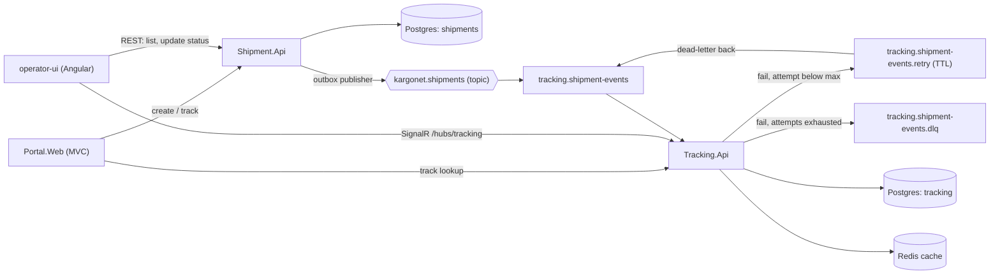

# KargoNet — Shipment Tracking Microservices

KargoNet is a .NET 10 shipment-tracking system built as microservices: a **Shipment** service and a **Tracking** service that exchange shipment events over **RabbitMQ** with hand-built **retry and dead-letter queues**, **PostgreSQL** for storage, a **Redis** cache for tracking lookups, an **ASP.NET Core MVC** customer portal, and an **Angular** operator screen that receives live updates over **SignalR**. Everything runs as a single Docker Compose stack.

The core guarantee: a status change made in the operator UI must reach the customer portal and the operator's live view **without loss**, even when RabbitMQ or an individual consumer is temporarily down.

## Architecture



Key mechanics:

- **Outbox:** a status change and its event row are saved in one EF transaction; a background publisher polls, publishes with confirms, and marks rows sent — events are not lost if RabbitMQ is down.
- **Retry and DLQ:** on failure the consumer republishes to the retry queue (TTL) with `x-retry-count` incremented; once retries (3) are exhausted the message goes to the DLQ with an `x-exception` header. Either way the original message is acked.
- **Idempotency:** each event is applied at most once — a `ProcessedEvents` marker is checked by `EventId` inside the same transaction as the read-model update.
- **Redis cache-aside:** `GET /api/tracking/{number}` serves from `tracking:{number}` (10-minute TTL); the entry is deleted when a new event for that shipment is consumed.
- **SignalR:** after each processed event, the Tracking API broadcasts `ShipmentUpdated` to all operator clients and to a group named after the tracking number.

## Prerequisites

- Docker with Docker Compose (the default stack needs nothing else)

## Quick start

```bash
docker compose up --build
```

All 8 services start with health-gated ordering. When every service reports `healthy`:

| Service | Host port | What it is |
|---|---|---|
| portal-web | 5000 | Customer portal (ASP.NET Core MVC) |
| operator-ui | 4200 | Operator screen (Angular + nginx; proxies `/api` → shipment-api, `/hubs` → tracking-api) |
| shipment-api | 5001 | Shipment REST API |
| tracking-api | 5002 | Tracking REST API + SignalR hub + DLQ admin |
| postgres | 5432 | `shipments` and `tracking` databases |
| rabbitmq | 5672 / 15672 | Broker / management UI |
| redis | 6379 | Tracking cache |

Teardown when you're done: `docker compose down` (add `-v` to also drop the Postgres volumes; the databases are re-created on the next first-time start).

Databases, tables, and RabbitMQ topology are created automatically on first start (init script + in-process EF migrations at API startup) — no manual setup.

## Demo walkthrough

1. **Create a shipment in the portal:** open <http://localhost:5000>, use the create-shipment form (tracking number, description, destination). The portal POSTs to the shipment API → `201 Created`.
2. **Watch it in the operator screen:** open <http://localhost:4200>. The new shipment appears in the table, live badge included.
3. **Advance the status:** in the operator screen, change the status (PickedUp → InTransit → …). The call is `PUT /api/shipments/{id}/status` on the shipment API.
4. **Live update:** the operator row's badge updates in real time over SignalR — no refresh needed.
5. **Portal timeline:** the portal's tracking view (`/track?number=…`) now shows the updated status plus a timeline entry for each status change.
6. **DLQ bonus:** publish a poison message to the `tracking.shipment-events` queue (e.g. via the RabbitMQ management UI at <http://localhost:15672>). Watch `x-retry-count` increment as it bounces through the retry queue, then land in `tracking.shipment-events.dlq`. Recover it with:

   ```bash
   curl -X POST http://localhost:5002/api/admin/dlq/replay
   ```

   and confirm it is reprocessed (the DLQ count drops).

## Development mode (without Docker)

Run each piece on the host:

- **Infrastructure:** local Postgres (databases `shipments` and `tracking`), RabbitMQ, and Redis. The credentials in the root `.env` are the defaults used by the app configs — change them for anything shared.
- **APIs:** `dotnet run` in `src/Services/Shipment.Api` (port 5001) and `src/Services/Tracking.Api` (port 5002). Migrations run in-process at startup.
- **Portal:** `dotnet run` in `src/Web/Portal.Web` (port 5000).
- **Operator UI:** `npm install && npm run start` in `src/Web/operator-ui` (`ng serve`, port 4200). The dev `environment.ts` points at absolute `localhost:5001`/`localhost:5002` bases.

## Project layout

```
src/BuildingBlocks/KargoNet.Contracts   Event records, ShipmentStatus enum, envelope
src/BuildingBlocks/KargoNet.Messaging   Rabbit topology, publisher, consumer base with retry/DLQ
src/Services/Shipment.Api               Shipment REST API, outbox, background publisher
src/Services/Tracking.Api               Event consumer, read model, Redis cache, SignalR hub, DLQ admin
src/Web/Portal.Web                      Customer portal (MVC)
src/Web/operator-ui                     Angular operator screen + nginx proxy config
tests/KargoNet.Tracking.Tests           xUnit: retry decisions, idempotency, cache, consumer, API
tests/KargoNet.Portal.Tests             xUnit: portal controllers
docker/postgres/init.sql                Creates the shipments and tracking databases
docker-compose.yml                      The 8-service stack
.env                                    Local dev credentials/connection strings (defaults)
```

## Tests

```bash
dotnet test              # full xUnit suite (repo root)
```

and in `src/Web/operator-ui`:

```bash
npm test                 # vitest suite
```

The suite covers the three core reliability areas:

- **Retry decisions** — `RetryPolicyTests` (republish at counts 1 and 2, route to DLQ at the cap) and `ShipmentEventsConsumerTests` (`Handler_failure_routes_to_retry_then_dlq_and_always_ackd`, `Unknown_event_type_routes_to_retry_then_dlq_and_always_ackd`, `DbUpdateException_without_committed_marker_is_rethrown_and_routed_to_retry`).
- **Idempotency** — `ShipmentEventsConsumerTests` (`Redelivered_same_event_id_is_applied_exactly_once_and_ackd`, `Race_backstop_committed_marker_is_ackd_as_success_without_retry`, `Race_backstop_duplicate_processed_marker_returns_success_without_rethrowing`).
- **Cache invalidation** — `ShipmentEventsConsumerTests.Status_changed_body_updates_status_and_appends_timeline_row` (asserts the cache entry is deleted on every applied event) plus the cache-aside endpoint tests in `TrackingEndpointTests` (`Get_known_tracking_number_returns_200_dto_and_warms_the_cache`, `Second_get_is_served_from_cache_not_the_database`, `Get_degrades_to_EF_when_the_cache_fails`).

## DLQ admin endpoints (tracking-api)

- `GET /api/admin/dlq` — count of messages currently in the dead-letter queue
- `POST /api/admin/dlq/replay` — requeue all DLQ messages back to the main queue and report how many were replayed
